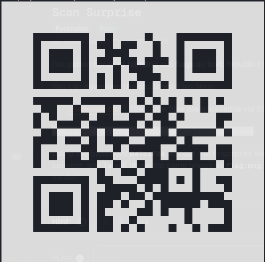

# Scan Surprise — CTF Write-up

| | | | |
|---|---|---|---|
| **Challenge** | Scan Surprise | **Category** | Forensics |
| **Event** | picoCTF 2024 | **Difficulty** | Easy |
| **Author** | Jeffery John | **Platform** | CyLab Academy |
| **Solved** | 2026-11-28 | **Files** | `challenge.zip` → `flag.png` (also via SSH) |

> **Flag:** `academy{p33k_@_b00_36769c4b}`
> *"peek-a-boo"*. The flag was in plain sight, just in a form people can't read without a scanner.

## 1. TL;DR
The flag is stored as a **QR code** image (`flag.png`). It comes as a zip, and over SSH, where the QR code is drawn in the terminal as soon as you connect. Scanning the QR code with a phone or `zbarimg` gives the flag as plain text. There's no hidden data and no encoding beyond the QR code itself.

## 2. The challenge
> *"I've gotten bored of handing out flags as text. Wouldn't it be cool if they were an image instead?"*

The title (**Scan**) and the description say it outright: the flag is an image meant to be **scanned**.

## 3. Analysis

### 3.1 Unpack
```bash
unzip challenge.zip
file flag.png        # PNG image data
```

### 3.2 Same file over SSH
```bash
ssh -p <port> ctf-player@xebec.cylabacademy.net
```
The QR code **prints in the terminal as soon as you log in** (drawn with block characters), and `ls` shows the same `flag.png`. Either view works.



### 3.3 Decode the QR code
| Method | How |
|---|---|
| **Phone camera (what we used)** | Point the camera at the QR code on screen |
| Command line | `zbarimg flag.png` (install with `sudo apt install zbar-tools`) |
| CyberChef | **Parse QR Code** operation, drop in the PNG |

```
academy{p33k_@_b00_36769c4b}
```

## 4. The key decision: pick the right tool
| Approach | Why it fails / wins |
|---|---|
| `strings flag.png \| grep academy` | The flag is stored in the pixel pattern, not as bytes in the file |
| `exiftool` / LSB tools (RED-style) | Nothing hidden. The QR code *is* the data |
| Read the image by eye (like Binary Digits) | A QR code isn't human-readable |
| **Scan it with a QR reader (chosen)** | Phone or `zbarimg`, instantly |

> **The core insight:** not every image challenge is steganography. Read the description first. When it says the flag is an image, use the tool that matches that kind of image (a QR code needs a QR reader).

## 5. The solver
**What we used:**
```
unzip challenge.zip  →  open flag.png (or SSH in)  →  scan the QR code with a phone
```
**Command-line equivalent:**
```bash
unzip challenge.zip && zbarimg flag.png
# QR-Code:academy{p33k_@_b00_36769c4b}
```
> **Gotcha:** the terminal-drawn QR code can fail to scan if the terminal window is too small (it wraps the lines) or uses a light theme (inverted colours). Make the window bigger, or scan the PNG file instead.

## 6. The run
```
QR-Code: academy{p33k_@_b00_36769c4b}
```

## 7. Takeaways
**Solving:**
- **Read the description before reaching for stego tools.** "Image instead of text" + "Scan" = QR code.
- **Have a QR/barcode reader ready:** `zbarimg` (CLI), CyberChef **Parse QR Code**, or your phone.
- **The image *is* the data.** You need the right reader, not a hunt for hidden bytes.
- **Carried forward:**
  - *Binary Digits / Flag in Flame / Corrupted file*: look at the image. Here it needed a scanner instead of your eyes.
  - *DISKO 1*: cheapest check first. Scanning took seconds, so no stego tools were needed.

**Security:**
- **QR codes hide their contents from people.** You can't tell where one points until you scan it. "Quishing" (QR phishing) puts malicious links in QR codes on posters, emails and parking meters, and it gets past email link scanners because the link is inside an image.
- Defenders decode QR codes in suspicious emails or attachments (`zbarimg`) to pull out the URL and check it before anyone visits it.

## 8. Pivot Log
| # | Pivot | Trigger |
|---|---|---|
| 1 | Treat the image as a **QR code** to scan, not a stego container | Title "Scan Surprise" + "flags as an image" |
| 2 | **Scan it** (phone / `zbarimg`) | QR code printed on SSH login and stored as `flag.png` |

**References:** picoCTF 2024: Scan Surprise · Tools: `unzip`, `ssh`, phone QR scanner, `zbarimg`, CyberChef (Parse QR Code)
