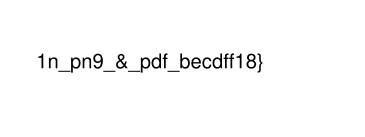

# Secret of the Polyglot — CTF Write-up

| | | | |
|---|---|---|---|
| **Challenge** | Secret of the Polyglot | **Category** | Forensics |
| **Event** | picoCTF 2024 | **Difficulty** | Easy |
| **Author** | syreal | **Platform** | CyLab Academy |
| **Solved** | 2026-11-28 | **File** | `flag2of2-final.pdf` |

> **Flag:** `academy{f1u3n7_1n_pn9_&_pdf_becdff18}`
> *"fluent in PNG & PDF"*. One file, two valid formats, half the flag in each.

## 1. TL;DR
`flag2of2-final.pdf` is a **polyglot**: a single file that is a valid **PNG** *and* a valid **PDF**. `file` only reads the first bytes, so it reports PNG. Opening it as an image shows the **first half** of the flag. Opening it as a PDF shows the **second half**. Join them for the full flag.

## 2. The challenge
> *"...they're getting **conflicting information on what type of file it is**... Can you **extract all the information** from this strange file?"*

Three clues:
- **"conflicting information"** → different tools will say different things about the file type.
- **"all the information"** → there's more than one part to find.
- **`flag2of2`** in the filename → the flag is split in two.

## 3. Analysis

### 3.1 Identify by bytes, not extension
```bash
file flag2of2-final.pdf
# PNG image data, 200 x 40, 4-bit colormap, non-interlaced
xxd flag2of2-final.pdf | head -n 2
# 00000000: 8950 4e47 0d0a 1a0a 0000 000d 4948 4452  .PNG........IHDR
```
The **PNG** signature `89 50 4E 47 0D 0A 1A 0A` and the `IHDR` chunk are right at byte 0, but the extension says **`.pdf`**. That's the "conflicting information".

### 3.2 Why it can be both
| Format | How readers find it |
|---|---|
| **PNG** | Must start with its signature at byte 0. Reads chunks until `IEND` and **ignores anything after it** |
| **PDF** | Readers **search** for `%PDF` near the start rather than requiring it at byte 0, and find objects through the cross-reference table at the end |

So PNG data at the front plus PDF structure inside the file gives one file that both kinds of reader accept.

```bash
grep -a -c "%PDF" flag2of2-final.pdf     # confirms PDF content is also present
```

### 3.3 Open it as a PNG → first half
```bash
cp flag2of2-final.pdf as.png && xdg-open as.png
```

```
academy{f1u3n7_
```

### 3.4 Open it as a PDF → second half
```bash
xdg-open flag2of2-final.pdf
```

```
1n_pn9_&_pdf_becdff18}
```

### 3.5 Join
```
academy{f1u3n7_  +  1n_pn9_&_pdf_becdff18}  =  academy{f1u3n7_1n_pn9_&_pdf_becdff18}
```

## 4. The key decision: pick the right tool
| Approach | Why it fails / wins |
|---|---|
| Trust `file` → treat it as a PNG only | Gets half the flag (`academy{f1u3n7_`) and misses the PDF part |
| Trust the extension → open as PDF only | Gets the other half only |
| `strings \| grep academy` | Both halves are **rendered** (drawn in the image / compressed in the PDF), so they don't appear as plain text |
| **Open the file as *each* format it claims to be (chosen)** | PNG view + PDF view = both halves |

> **The core insight:** a polyglot works because each format's reader only looks at the parts it cares about. When the bytes and the extension disagree, check **both**. They can both be right.

## 5. The solver
**What we used:**
```bash
cp flag2of2-final.pdf as.png && xdg-open as.png     # first half
xdg-open flag2of2-final.pdf                         # second half
```
> **Gotcha:** some image viewers pick the format from the **extension**, so they won't show `.pdf` as an image. Copy or rename it to `.png` first. The PDF side is the reverse: open the original `.pdf` in a PDF viewer or browser.

## 6. The run
```
PNG view : academy{f1u3n7_
PDF view : 1n_pn9_&_pdf_becdff18}
Flag     : academy{f1u3n7_1n_pn9_&_pdf_becdff18}
```

## 7. Takeaways
**Solving:**
- **When the extension and the signature disagree, consider a polyglot,** especially if the description mentions conflicting file types.
- **Open the file as every type it might be.** Each one can reveal different content.
- **Read the filename:** `2of2`, `part1`, `_a` / `_b` mean you're looking for multiple pieces.
- **Carried forward:**
  - *Corrupted file cheat sheet*: trust the bytes (`89 50 4E 47` = PNG), but here the extension wasn't lying either.
  - *Binary Digits / Flag in Flame*: look at the rendered output. Both halves were drawn, not stored as text.

**Security (SOC angle):**
- **Polyglots are a real evasion technique.** A security tool that identifies a file by one signature can classify it as harmless (e.g. "just an image") while another program opens it as a document or script with active content.
- File type detection shouldn't rely on the extension **or** a single signature check alone. Look for multiple format markers (`%PDF`, `PK`, `MZ`) inside the file, e.g. with `binwalk` or `grep -a`.
- This is why mail gateways often re-render or sanitise attachments instead of trusting their declared type.

## 8. Pivot Log
| # | Pivot | Trigger |
|---|---|---|
| 1 | Identify by **bytes**: it's a PNG | `file` and `xxd` show the PNG signature, despite the `.pdf` extension |
| 2 | Realise the extension is **also** true | Challenge title "Polyglot" + "conflicting information" |
| 3 | Open it **as a PNG** | Shows the first half: `academy{f1u3n7_` |
| 4 | Open it **as a PDF** | Shows the second half: `1n_pn9_&_pdf_becdff18}`. The filename `flag2of2` confirmed two pieces |

**References:** picoCTF 2024: Secret of the Polyglot · Tools: `file`, `xxd`, `grep -a`, image viewer, PDF viewer
